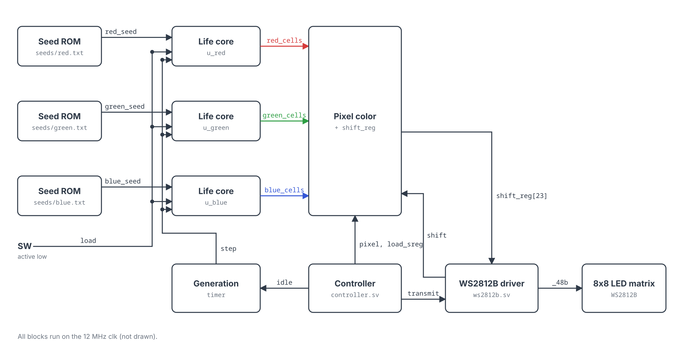
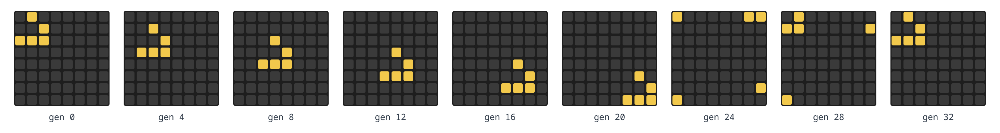
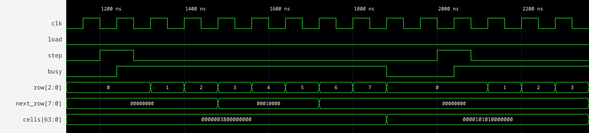

# ENGR 3410 Miniproject 3: Three Games of Life on an 8×8 LED Matrix

Dhvan Shah

[Source code and test benches](https://github.com/Dh-Van/comp-arc-mp3)

[Video Demo](https://drive.google.com/file/d/17uaaHj3DryF-LwgEkJKj5rQfmdF2anGg/view?usp=sharing)

## Overview

My circuit plays the second variant from the assignment: three independent Games of Life on the same 8×8 grid, one on the red LEDs, one on the green, and one on the blue. Each game follows the normal rules and ignores the other two. When a cell is alive in more than one game, the colors mix on that LED, so you also see yellow, cyan, magenta, and white. The grid wraps around in both directions, so a cell on the right edge counts cells on the left edge as neighbors, and the same goes for top and bottom.

Each game starts from its own `$readmemh` seed file, and holding the SW button reloads all three seeds.

## Architecture



*Figure 1. Block diagram of `top.sv`. Wire labels are signal names in the code.*

Figure 1 shows the design. `top.sv` makes three copies of my `life` module, each loaded by a `seed_rom` that reads one seed file. The LED driver (`controller.sv` and `ws2812b.sv`) comes from the course's `led_matrix` example. The controller sends the 64 pixels in order, 24 bits each, and then waits out an idle gap, which gives 32 frames per second at 12 MHz. For each pixel, `top` loads a shift register with `BRIGHTNESS` (0x20) or 0 for each of green, red, and blue, depending on whether that cell is alive in each game. I store each board as 64 bits with cell `(row, col)` at bit `row*8 + col`, which is the same order the matrix uses, so picking a pixel's color is just indexing each board with the pixel number.

The only change I made to the controller was adding an `idle` output. `top` counts idle gaps and pulses `step` every 8th one, so the games advance 4 times per second and only between frames. Without this, a frame could show the top of one generation and the bottom of the next. `load` copies the seeds into the boards on power-up and while SW is held.

### The Life core

The rule is simple: a cell is alive next generation if it has exactly 3 live neighbors, or if it is already alive and has exactly 2. My first idea was to compute all 64 cells at once. Brad told us not to brute force it like this, so I synthesized that version by itself to see why. Three games done that way used 2,429 of the UP5K's 5,280 LUTs (46%) before adding anything else.

Instead, `life.sv` computes one row per clock. Row `r`'s next state only depends on rows `r-1`, `r`, and `r+1`. The row counter is 3 bits, so `row - 1` and `row + 1` wrap from 0 to 7 and back on their own, which handles the vertical wraparound for free. For the columns, each row is an 8-bit value, and rotating it one bit left or right lines every cell up with its left or right neighbor. Rotating also carries column 0 around to column 7. After rotating all three rows, a cell's 8 neighbors are the same bit position in 8 different bytes, so I add those up and apply the rule. That logic is a SystemVerilog function, which I used for the first time on this project.

Each new row goes into a second buffer instead of back into the board, because the next row still needs the old values. After all 8 rows, the whole buffer is copied into the board at once. A generation takes 8 clocks (0.67 µs), which easily fits in the 29 ms idle gap. Three games done this way use 973 LUTs (18%). That is about 2.5 times smaller, not 8 times, because selecting the three rows each clock and holding the second buffer take logic too.

## Simulation

`life_tb.sv` runs one Life core in iverilog and checks it against patterns whose behavior is known. A block (2×2 square) should stay the same. A blinker (3 in a row) should flip between horizontal and vertical every generation. A blinker centered on the corner cell should flip the same way even though its cells and neighbors wrap across both edges. A glider should move one cell diagonally every 4 generations and be back at its starting spot after 32 generations, which means it wrapped across both edges. The test bench compares the board against the expected one and prints pass or fail for each check:

```
pass block unchanged after 1 generation
pass blinker flips to vertical
pass blinker flips back to horizontal
pass corner blinker flips across top/bottom edge
pass corner blinker flips back across left/right edge
pass glider shifted (1,1) after 4 generations
...
pass glider shifted (8,8) after 32 generations
ALL CHECKS PASSED
```



*Figure 2. The glider test in `life_tb.sv`, every 4th generation. It wraps across the edges and is back at its start at generation 32.*



*Figure 3. One generation of the blinker test, drawn from the `life_tb` VCD file.*

Figure 3 shows one generation being computed. `step` pulses, `busy` goes high, and `row` counts 0 to 7. `next_row` is `00010000` for rows 3, 4, and 5, which is column 4. When `busy` drops, `cells` changes all at once from `0x38` in row 4 (a horizontal blinker in columns 3 to 5) to `0x10` in rows 3, 4, and 5 (a vertical blinker in column 4).
